<!-- README baseado no template do Prof. Dr. João Paulo Aramuni (desenvolvimento-e-integracao-de-aplicacoes-web) -->

---

# 🚗 Aluguel de Carros 👨‍💻

> [!NOTE]
> Sistema web de aluguel de automóveis: o **cliente faz o pedido pela internet** e acompanha cada etapa, enquanto **empresas e bancos analisam a renda, aprovam e executam o contrato**, com crédito opcional concedido pelo banco.

<table>
  <tr>
    <td width="800px">
      <div align="justify">
        Projeto do <b>LAB02 da disciplina de Desenvolvimento e Integração de Aplicações Web (DIAW)</b> da <b>PUC Minas</b>. O sistema é dividido nos dois subsistemas pedidos no enunciado: a <i>Gestão de Pedidos e Contratos</i>, uma API REST em <b>Spring Boot</b> com autenticação <b>JWT</b> e banco <b>PostgreSQL (Supabase)</b>, e a <i>Construção Dinâmica das Páginas Web</i>, um front-end em <b>React + Vite</b>. Cada pedido segue um ciclo controlado: nasce <b>em análise</b>, é <b>aprovado</b> ou <b>reprovado</b> por um agente e, se aprovado, vira <b>contrato</b>. O tipo do contrato define se o carro fica registrado em nome do cliente, da empresa ou do banco. Todas as 22 regras de negócio da modelagem estão implementadas e documentadas.
      </div>
    </td>
    <td>
      <div>
        
      </div>
    </td>
  </tr>
</table>

---

## 🚧 Status do Projeto


---

## 📚 Índice
- [Links Úteis](#-links-úteis)
- [Sobre o Projeto](#-sobre-o-projeto)
- [Funcionalidades Principais](#-funcionalidades-principais)
- [Tecnologias Utilizadas](#-tecnologias-utilizadas)
- [Arquitetura](#-arquitetura)
  - [Diagramas](#diagramas)
- [Instalação e Execução](#-instalação-e-execução)
  - [Pré-requisitos](#pré-requisitos)
  - [Variáveis de Ambiente](#-variáveis-de-ambiente)
  - [Instalação de Dependências](#-instalação-de-dependências)
  - [Inicialização do Banco de Dados (PostgreSQL)](#-inicialização-do-banco-de-dados-postgresql)
  - [Como Executar a Aplicação](#-como-executar-a-aplicação)
- [Deploy](#-deploy)
- [Estrutura de Pastas](#-estrutura-de-pastas)
- [Demonstração](#-demonstração)
  - [Aplicação Web](#-aplicação-web)
  - [Versão para Celular](#-versão-para-celular)
  - [Exemplo de saída no Terminal (API)](#-exemplo-de-saída-no-terminal-api)
- [Testes](#-testes)
- [Documentações utilizadas](#-documentações-utilizadas)
- [Autores](#-autores)
- [Contribuição](#-contribuição)
- [Agradecimentos](#-agradecimentos)
- [Licença](#-licença)

---

## 🔗 Links Úteis
* 📐 **Modelagem:** [docs/MODELAGEM.md](docs/MODELAGEM.md)
  > 📚 Premissas, as 22 regras de negócio, as histórias de usuário e os diagramas UML (casos de uso, classes e pacotes).
* 🖥️ **Documentação do Back-end:** [backend/README.md](backend/README.md)
  > ☕ Endpoints, perfis de acesso, formato dos erros e onde cada regra de negócio está no código.
* 🎨 **Documentação do Front-end:** [frontend/README.md](frontend/README.md)
  > ⚛️ Telas por perfil, estrutura do código, comunicação com a API e identidade visual.
* 🌐 **Demo online:** [DemoOnline](https://sistema-de-aluguel-de-carros-ecru.vercel.app/login)

---

## 📝 Sobre o Projeto

**Por que existe:** o enunciado do LAB02 pede um sistema de apoio à gestão de aluguéis de automóveis em que os pedidos sejam feitos, modificados e cancelados pela internet, e avaliados por agentes antes de virarem contrato.

**Qual problema resolve:** sem o sistema, o pedido de aluguel passa por papel, telefone e e-mail entre cliente, locadora e banco. Aqui ele vira um registro único, com dono, histórico de status, parecer do agente e regras que impedem situações inválidas, como aprovar um pedido cancelado ou alugar o mesmo carro duas vezes no mesmo período.

**Quem usa:**

| Perfil | O que faz |
|---|---|
| 👤 **Cliente** | se cadastra com RG, CPF, endereço, profissão e até 3 rendimentos; faz, modifica e cancela os próprios pedidos |
| 🏢 **Empresa** (agente) | avalia pedidos, executa contratos e mantém a frota de automóveis |
| 🏦 **Banco** (agente) | faz o mesmo que a empresa e, além disso, concede contrato de crédito para financiar o aluguel |

**Contexto:** acadêmico (PUC Minas, Engenharia de Software). As premissas adotadas para os pontos em aberto do enunciado estão em [docs/MODELAGEM.md](docs/MODELAGEM.md#1-premissas-adotadas). Por exemplo, os agentes não se cadastram pela tela: são criados por carga inicial.

---

## ✨ Funcionalidades Principais

- 🔐 **Autenticação com JWT:** cadastro público de cliente, login com usuário e senha (BCrypt) e rotas protegidas por perfil.
- 👤 **Cadastro do cliente:** dados pessoais, endereço e até 3 rendimentos, com CPF validado pelos dígitos verificadores.
- 🚘 **Frota de automóveis:** os agentes mantêm os carros (matrícula, ano, marca, modelo e placa únicos), e cada carro aparece desenhado como placa Mercosul.
- 📝 **Pedidos de aluguel:** o cliente escolhe o carro e as datas, acompanha o status e modifica ou cancela enquanto as regras permitem.
- 🔎 **Análise financeira:** o agente vê a renda declarada e a profissão do cliente e registra um parecer que aprova ou reprova o pedido.
- 📅 **Disponibilidade do carro:** o sistema impede aprovar dois pedidos do mesmo carro com períodos sobrepostos.
- 📄 **Execução de contrato:** o agente define quem fica com o carro (cliente, empresa ou banco), e o proprietário do automóvel é registrado.
- 💳 **Contrato de crédito:** só bancos concedem crédito; a parcela é calculada pela Tabela Price, com prévia antes de confirmar.
- 🧾 **Erros padronizados:** toda resposta de erro tem o mesmo formato JSON, e o front mostra a mensagem embaixo do campo certo.
- 📱 **Responsivo:** todas as telas funcionam no celular.

---

## 🛠 Tecnologias Utilizadas

### 💻 Front-end

* **Biblioteca:** React 19.3
* **Linguagem:** JavaScript (ES2022+, JSX)
* **Roteamento:** React Router 7.18
* **Estilização:** CSS puro com tokens de cor e tipografia, sem framework de UI
* **Gerenciamento de Estado:** Context API (sessão e avisos)
* **Build Tool:** Vite 8.3
* **Qualidade:** oxlint
* **Fontes:** Barlow Condensed, Atkinson Hyperlegible Next e Atkinson Hyperlegible Mono (Google Fonts)

### 🖥️ Back-end

* **Linguagem/Runtime:** Java 25 (JDK)
* **Framework:** Spring Boot 4.1.1 (Web MVC, Data JPA, Validation, Security)
* **Banco de Dados:** PostgreSQL hospedado no Supabase
* **ORM:** Hibernate / JPA, com herança `JOINED` para os tipos de usuário
* **Autenticação:** Spring Security + JWT (jjwt 0.12.6), senhas com BCrypt
* **Outros:** Lombok, Hibernate Validator (`@CPF`), Maven Wrapper
* **Testes:** JUnit 5 + AssertJ

### ⚙️ Infraestrutura

* **Banco gerenciado:** Supabase (conexão pelo *Session pooler*)
* **Containerização:** Docker, opcional, para subir um PostgreSQL local

---

## 🏗 Arquitetura

O sistema é **cliente-servidor em MVC**. O front-end React é a **View**; o back-end Spring Boot concentra **Controller** e **Model**:

- **Controller** (`controller/`): endpoints REST que recebem DTOs validados com `@Valid`, chamam o service e devolvem DTOs. Nunca expõem entidades.
- **Model**, em três partes:
  - `model/`: entidades JPA com as regras que dependem só do próprio objeto. Por exemplo, `PedidoAluguel.aprovar()` confere o status atual antes de mudar.
  - `service/`: regras que envolvem várias entidades, a checagem de dono do recurso e as transações (`@Transactional`).
  - `repository/`: consultas com Spring Data JPA.
- **View** (`frontend/`): páginas por perfil que consomem a API com o token JWT no header.

**Padrões adotados:**

- *Repository*, *Service Layer* e *DTO* (com `record`).
- *Rich Domain Model*: as transições de status ficam na entidade, não no service.
- Tratamento global de exceções (`@RestControllerAdvice`).
- Autenticação *stateless* com JWT.

**Fluxo de uma requisição:**

1. O front envia `Authorization: Bearer <token>`.
2. O `JwtAuthenticationFilter` valida o token e carrega o usuário.
3. O `SecurityConfig` confere o perfil da rota.
4. O controller chama o service, que aplica as regras e usa os repositories.
5. Qualquer erro sai pelo `GlobalExceptionHandler` no mesmo formato JSON.

**Decisões e trade-offs:**

| Decisão | Motivo | Limitação |
|---|---|---|
| Esquema criado pelo Hibernate (`ddl-auto=update`) | simplicidade no laboratório | sem histórico de migrações (Flyway seria o próximo passo) |
| JWT guardado no `localStorage` | API sem sessão, front simples | exige cuidado com XSS; o token expira em 24 h |
| Usuário recarregado do banco a cada requisição | conta excluída perde o acesso na hora | uma consulta a mais por requisição |
| Validação só no back-end | regra em um lugar só; o front mostra os erros por campo | uma ida ao servidor para validar |

### Diagramas

| Arquitetura | Ciclo de vida do pedido |
| :---: | :---: |
| 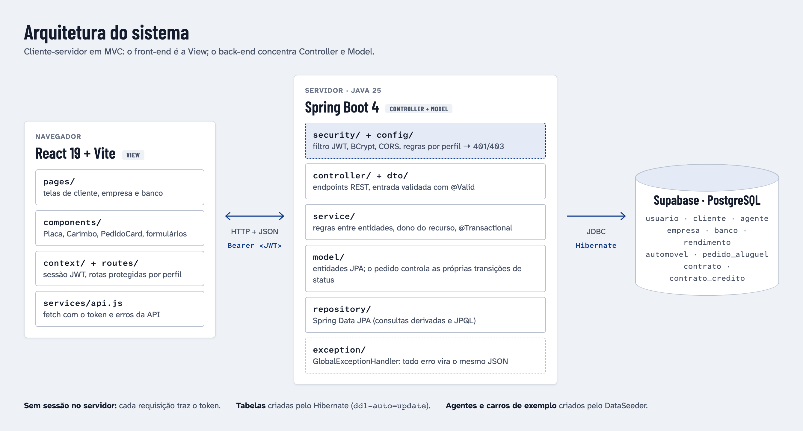 | 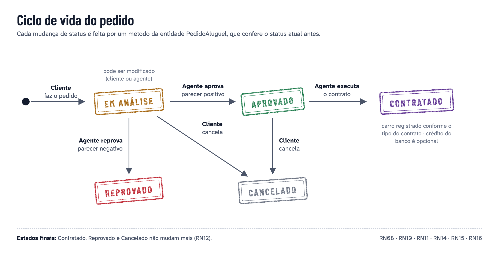 |
| **Diagrama de Classes** | **Diagrama de Pacotes** |
| 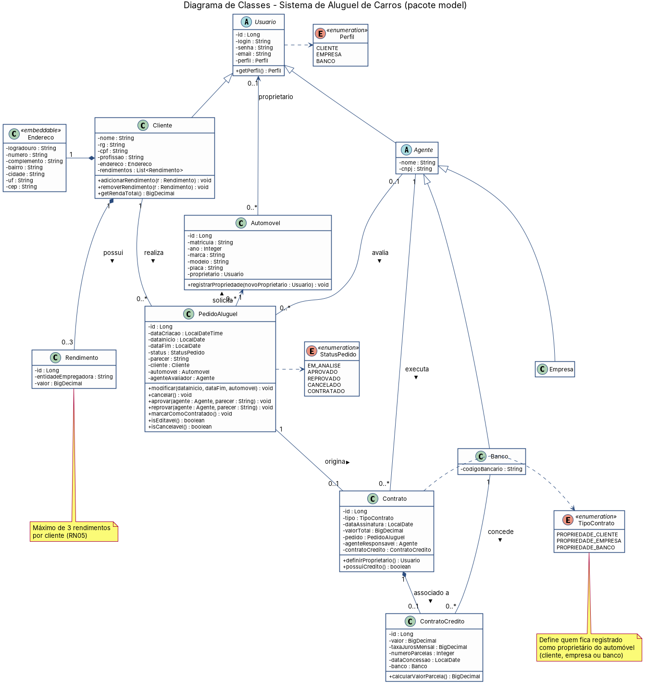 | 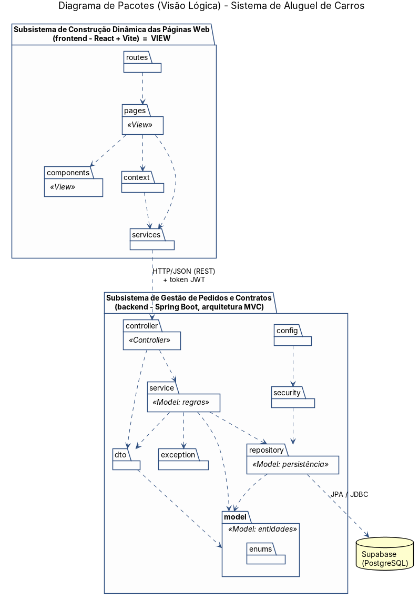 |
| **Casos de Uso** | |
| 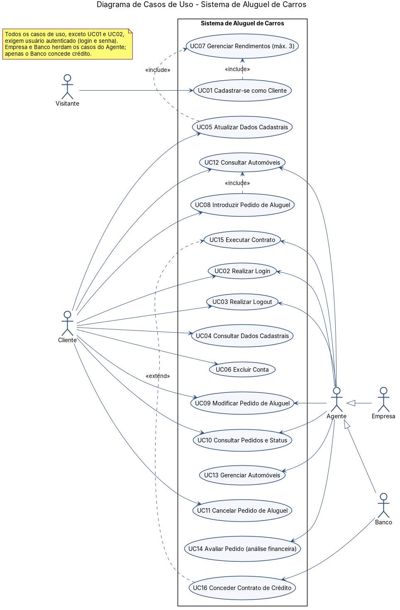 | |

---

## 🔧 Instalação e Execução

### Pré-requisitos

* **Java JDK 25** ou superior (back-end)
* **Node.js 22 LTS** ou superior, com npm (front-end; testado com o Node 24)
* **Git**
* **Banco PostgreSQL:** um projeto no [Supabase](https://supabase.com/) **ou** Docker para subir um banco local

> [!NOTE]
> Não é preciso instalar o Maven: o projeto usa o **Maven Wrapper** (`./mvnw`), que baixa a versão certa na primeira execução.

---

### 🔑 Variáveis de Ambiente

#### 1. Back-end (Spring Boot)

Copie o exemplo e preencha:

```bash
cp backend/.env.example backend/.env
```

| Variável | Descrição | Exemplo |
| :--- | :--- | :--- |
| `DB_URL` | URL JDBC do PostgreSQL | `jdbc:postgresql://aws-0-sa-east-1.pooler.supabase.com:5432/postgres` |
| `DB_USER` | usuário do banco | `postgres.abcdefghijklmnop` |
| `DB_PASSWORD` | senha do banco | `senha-do-banco` |
| `JWT_SECRET` | chave de assinatura dos tokens, com **pelo menos 32 caracteres** | `troque-por-um-texto-aleatorio-bem-longo` |
| `FRONTEND_URL` | origem liberada no CORS (aceita várias, separadas por vírgula) | `http://localhost:5173` |
| `SEED_SENHA_AGENTES` | senha dos agentes criados na carga inicial | `123456` |

> [!WARNING]
> O `.env` está no `.gitignore`. Nunca suba a senha do banco nem o `JWT_SECRET` para o GitHub.

#### 2. Front-end (React, Vite)

Opcional. Só é necessário se a API não estiver em `http://localhost:8080`:

```bash
cp frontend/.env.example frontend/.env
```

| Variável | Descrição | Exemplo |
| :--- | :--- | :--- |
| `VITE_API_URL` | URL base da API Spring Boot | `http://localhost:8080` |

---

### 📦 Instalação de Dependências

1. **Clone o repositório:**

```bash
git clone <URL_DO_REPOSITÓRIO>
cd SistemaAluguelCarros
```

2. **Front-end:**

```bash
cd frontend
npm install
cd ..
```

3. **Back-end:**

```bash
cd backend
./mvnw clean package -DskipTests
cd ..
```

> [!NOTE]
> O `-DskipTests` evita rodar o `AluguelcarrosApplicationTests`, que precisa do banco configurado. Os testes unitários estão em [Testes](#-testes).

---

### 💾 Inicialização do Banco de Dados (PostgreSQL)

**Opção A — Supabase (padrão do projeto):**

1. No painel do Supabase, abra o projeto e clique em **Connect**.
2. Use os dados do **Session pooler**: a conexão direta do plano gratuito é só IPv6.
3. Preencha `DB_URL`, `DB_USER` e `DB_PASSWORD` no `backend/.env`.

**Opção B — PostgreSQL local com Docker:**

```bash
docker run --name aluguel-db -e POSTGRES_PASSWORD=postgres -p 5432:5432 -d postgres:16
```

Depois, no `backend/.env`:

```
DB_URL=jdbc:postgresql://localhost:5432/postgres
DB_USER=postgres
DB_PASSWORD=postgres
```

**Esquema e dados iniciais:** nada precisa ser rodado à mão.

- Na primeira inicialização, o Hibernate cria as 10 tabelas: `usuario`, `cliente`, `agente`, `empresa`, `banco`, `rendimento`, `automovel`, `pedido_aluguel`, `contrato` e `contrato_credito`.
- O `DataSeeder` cria os agentes e 4 automóveis de exemplo.

---

### ⚡ Como Executar a Aplicação

Execute em **dois terminais**.

#### Terminal 1: Back-end (Spring Boot)

```bash
cd backend
./mvnw spring-boot:run
```
🚀 *A API estará disponível em **http://localhost:8080**.*

#### Terminal 2: Front-end (React, Vite)

```bash
cd frontend
npm run dev
```
🎨 *O front-end estará disponível em **http://localhost:5173**.*

#### 🔑 Contas para testar

| Login | Senha | Perfil |
|---|---|---|
| `empresa` | `123456` | Empresa |
| `banco` | `123456` | Banco |
| crie pela tela **Criar conta de cliente** | — | Cliente |

---

## 🚀 Deploy

O projeto ainda não está publicado. Para gerar os artefatos de produção:

```bash
# Front-end: arquivos estáticos em frontend/dist
cd frontend
VITE_API_URL=https://sua-api.exemplo.com npm run build

# Back-end: JAR executável em backend/target
cd ../backend
./mvnw clean package -DskipTests
```

Para executar:

```bash
# API (as variáveis do .env podem vir do ambiente do provedor)
java -jar backend/target/aluguelcarros-0.0.1-SNAPSHOT.jar

# Front-end: qualquer servidor de arquivos estáticos (Vercel, Netlify, Nginx...)
npx serve -s frontend/dist
```

> 🔑 **Variáveis cruciais em produção:**
> - `VITE_API_URL` é lida **no build** do front.
> - `FRONTEND_URL` da API precisa ser a URL pública do front, senão o CORS bloqueia as requisições.

---

## 📂 Estrutura de Pastas

```
.
├── README.md                    # 📘 Este documento.
├── .gitignore                   # 🧹 Ignora .env, node_modules, target, dist...
├── .vscode/                     # ⚙️ Configurações do VS Code.
├── imgs/                        # 🖼️ Logo, capturas de tela, GIFs e diagramas deste README.
├── docs/                        # 📚 Modelagem: MODELAGEM.md e diagramas UML (casos de uso, classes, pacotes).
│
├── backend/                     # ☕ API Spring Boot (Controller + Model)
│   ├── .env.example             # 🧩 Variáveis de ambiente do back-end.
│   ├── pom.xml                  # 🛠️ Dependências e build (Maven).
│   ├── mvnw, .mvn/              # 📦 Maven Wrapper.
│   ├── README.md                # 📘 Documentação da API.
│   └── src/
│       ├── main/java/br/pucminas/aluguelcarros/
│       │   ├── config/          # 🔧 SecurityConfig (rotas por perfil, CORS) e DataSeeder.
│       │   ├── security/        # 🛡️ JWT: geração, filtro, usuário logado, erros 401/403.
│       │   ├── controller/      # 🎮 Endpoints REST.
│       │   ├── service/         # ⚙️ Regras de negócio e transações.
│       │   ├── repository/      # 🗄️ Repositórios Spring Data JPA.
│       │   ├── model/           # 🧬 Entidades JPA e enums (Perfil, StatusPedido, TipoContrato).
│       │   ├── dto/             # ✉️ Records de entrada e saída (auth, cliente, automovel, pedido, contrato).
│       │   └── exception/       # 💥 Exceções de negócio e handler global.
│       ├── main/resources/
│       │   └── application.properties  # ⚙️ Configuração (lê o .env).
│       └── test/java/           # 🧪 Testes das regras dos models.
│
└── frontend/                    # ⚛️ Aplicação React + Vite (View)
    ├── .env.example             # 🧩 URL da API.
    ├── index.html               # 📄 Página base e fontes.
    ├── package.json             # 📦 Dependências e scripts.
    ├── public/                  # 📂 Favicon.
    ├── README.md                # 📘 Documentação do front-end.
    └── src/
        ├── pages/               # 📄 Telas: Login, Cadastro, Automoveis, PedidoForm, cliente/, agente/.
        ├── components/          # 🧱 Placa, Carimbo, PedidoCard, formulários, diálogos, navbar.
        ├── context/             # 🔐 Sessão (JWT) e avisos.
        ├── routes/              # 🧭 Rotas e proteção por perfil.
        ├── services/            # 🔌 Cliente HTTP da API.
        └── utils/               # 🛠️ Datas, moeda, máscaras, cálculo da parcela.
```

---

## 🎥 Demonstração

**O carimbo de cada etapa** (tela de login) e **a aprovação de um pedido pelo banco**:

| Caminho do pedido | Aprovação |
| :---: | :---: |
|  | 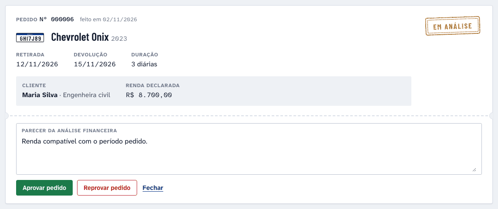 |

### 🌐 Aplicação Web

| Tela | Captura de Tela |
| :---: | :---: |
| **Login** | **Cadastro de cliente** |
| 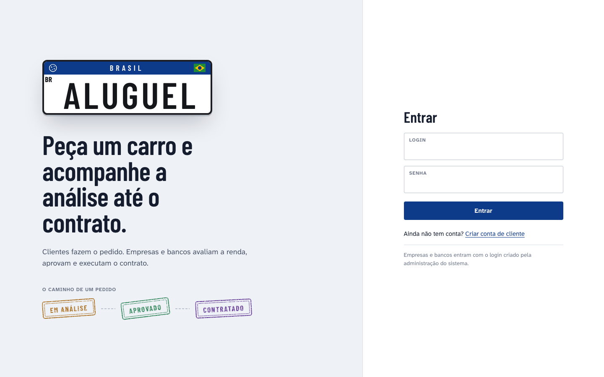 | 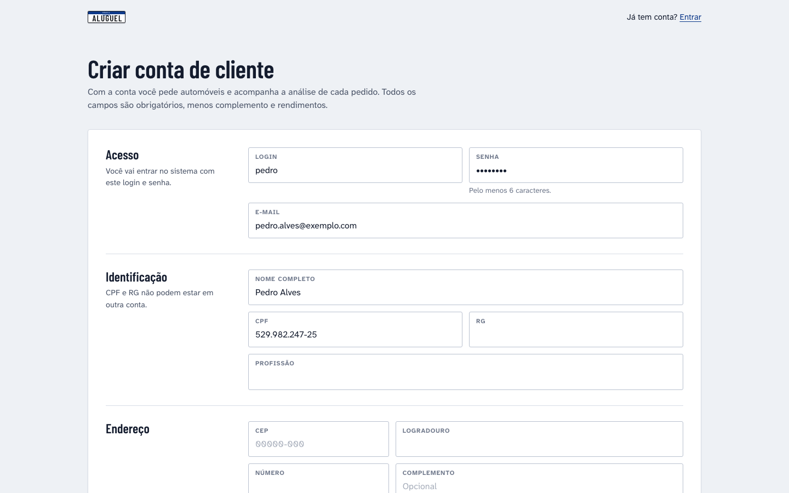 |
| **Cliente · Meus pedidos** | **Cliente · Novo pedido** |
| 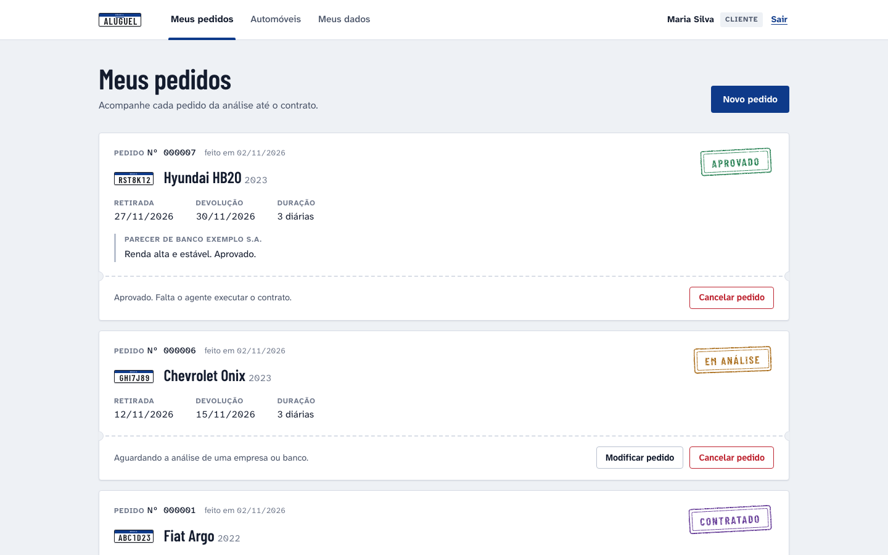 | 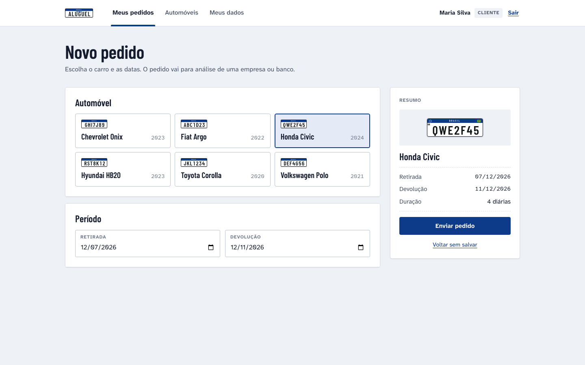 |
| **Cliente · Automóveis** | **Cliente · Meus dados** |
| 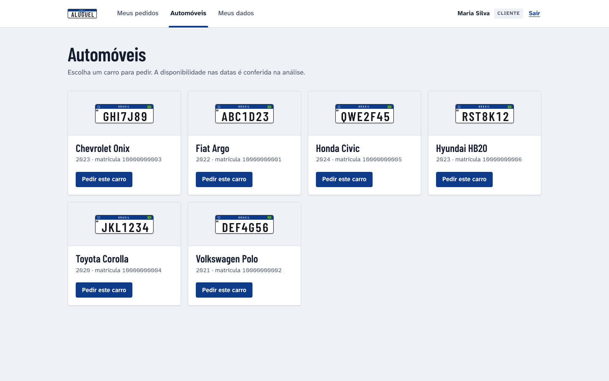 | 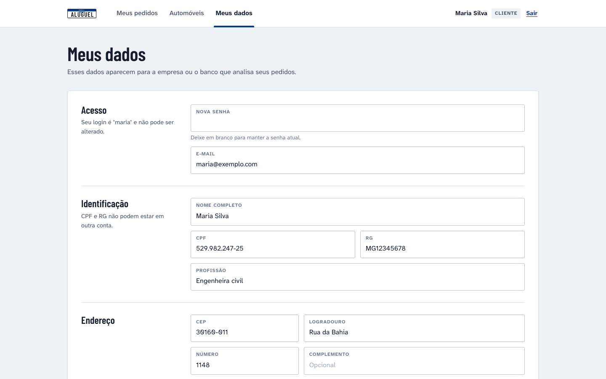 |
| **Agente · Pedidos em análise** | **Agente · Avaliação financeira** |
| 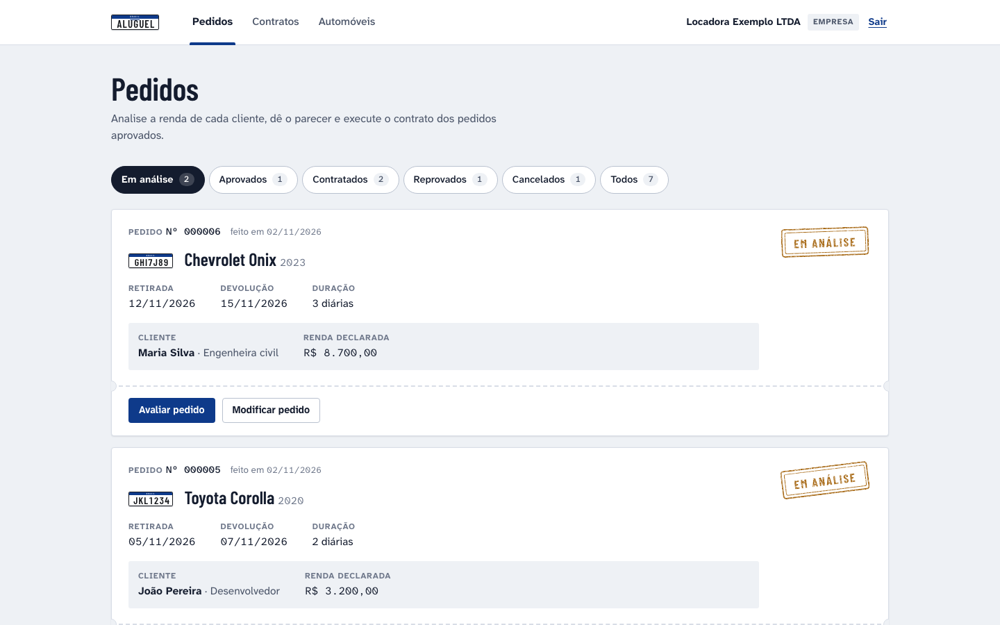 | 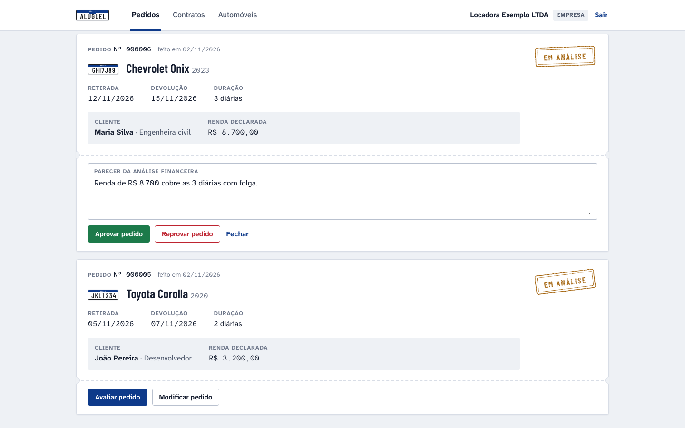 |
| **Agente · Executar contrato** | **Agente · Cadastrar automóvel** |
| 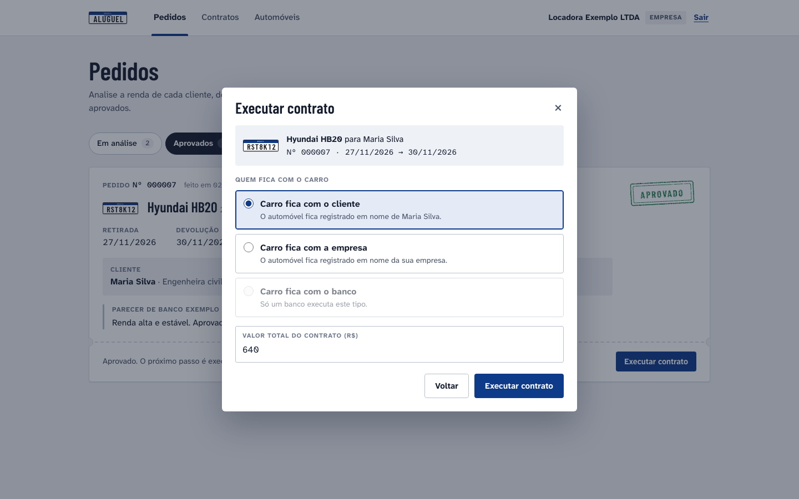 | 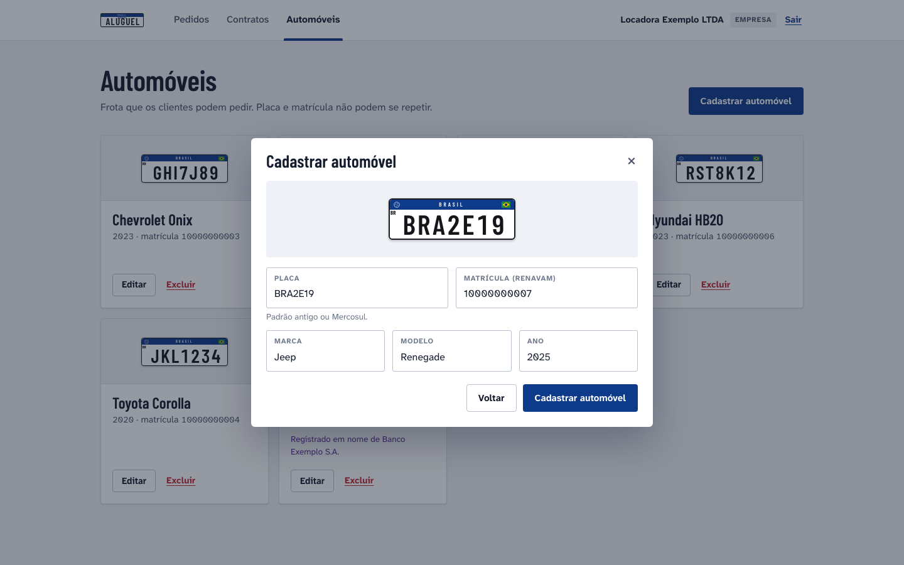 |
| **Banco · Contratos** | **Banco · Conceder crédito** |
| 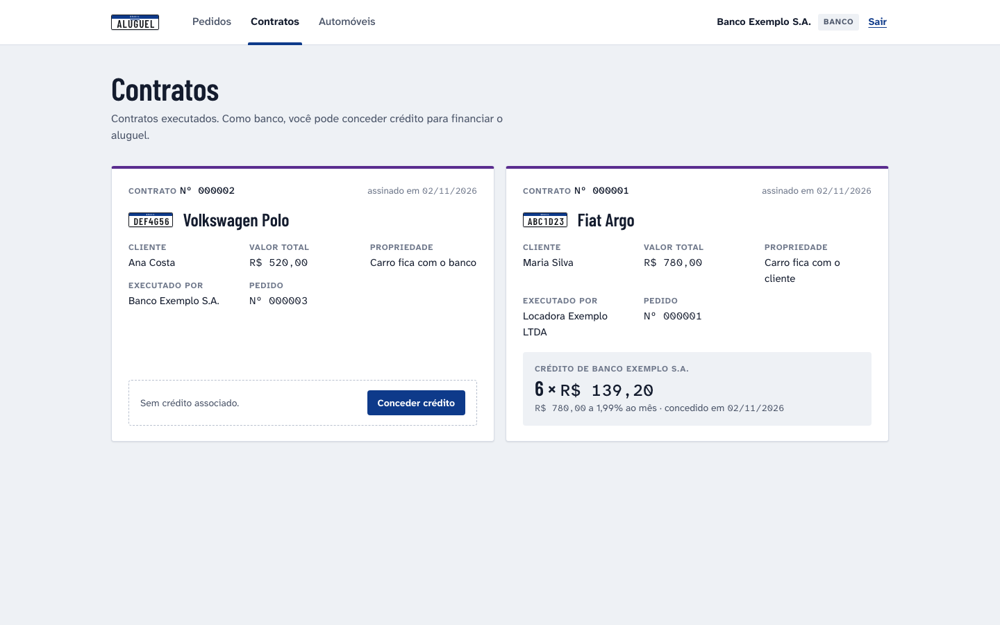 | 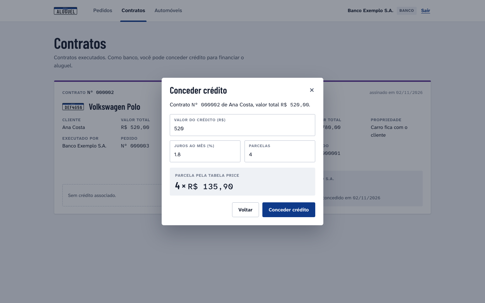 |

### 📱 Versão para Celular

| Login | Meus pedidos | Novo pedido | Pedidos (agente) |
|:---:|:---:|:---:|:---:|
| 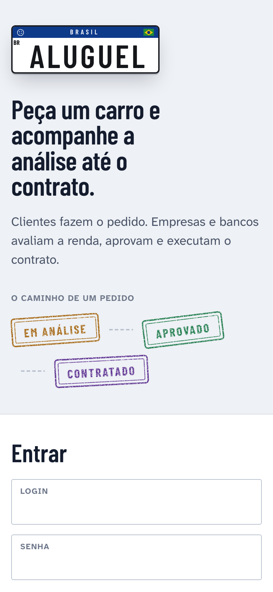 | 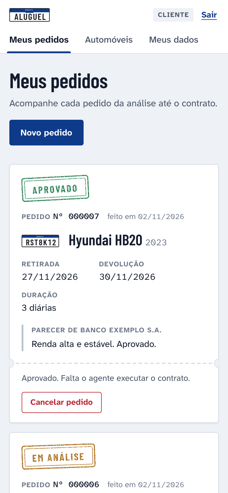 | 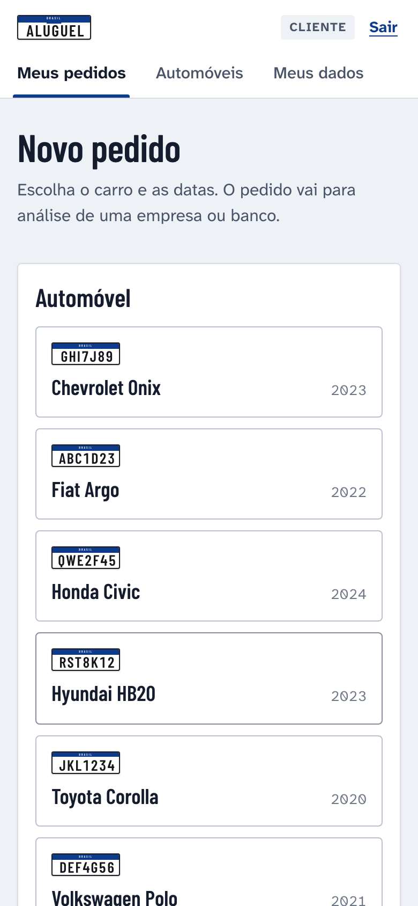 | 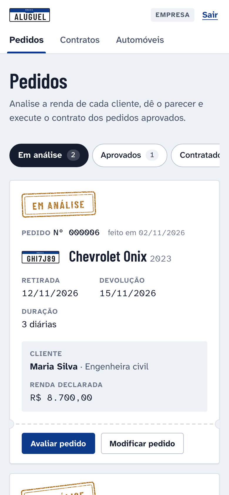 |

### 💻 Exemplo de Saída no Terminal (API)

#### 1. Login

```bash
curl -X POST 'http://localhost:8080/api/auth/login' \
     -H 'Content-Type: application/json' \
     -d '{"login": "maria", "senha": "segredo1"}'
```

**Saída esperada:**
```json
{
  "token": "eyJhbGciOiJIUzM4NCJ9.eyJzdWIiOiJtYXJpYSIsImlkIjozLCJwZXJmaWwiOiJDTElFTlRFIi...",
  "tipo": "Bearer",
  "id": 3,
  "login": "maria",
  "nome": "Maria Silva",
  "perfil": "CLIENTE"
}
```

#### 2. Pedido fora das regras

Tentando cancelar um pedido que já virou contrato:

```bash
curl -X PATCH 'http://localhost:8080/api/pedidos/1/cancelar' \
     -H 'Authorization: Bearer <token>'
```

**Saída esperada (HTTP 422):**
```json
{
  "timestamp": "2026-11-02T10:00:52.547361",
  "status": 422,
  "erro": "Unprocessable Content",
  "mensagem": "Só é possível cancelar pedidos em análise ou aprovados. Status atual: CONTRATADO.",
  "caminho": "/api/pedidos/1/cancelar",
  "campos": null
}
```

A lista completa de endpoints, com o perfil de cada um, está no [README do back-end](backend/README.md#endpoints).

---

## 🧪 Testes

### Testes Unitários (Back-end)

Testes das regras de negócio dos models: rendimentos, ciclo do pedido, proprietário do contrato e parcela pela Tabela Price.

```bash
cd backend
./mvnw test -Dtest='ClienteTest,PedidoAluguelTest,ContratoTest'
```
*Ferramentas: JUnit 5 + AssertJ (17 testes, sem banco).*

> [!NOTE]
> `./mvnw test` sem filtro também roda o `AluguelcarrosApplicationTests`, que sobe a aplicação inteira e conecta no banco do `.env`.

### Análise Estática (Front-end)

```bash
cd frontend
npm run lint
```
*Ferramenta: oxlint.*

### Testes End-to-End (E2E)

Ainda não há testes E2E no repositório.

---

## 🔗 Documentações utilizadas

* 📖 **Front-end:** [React](https://react.dev/reference/react) · [React Router](https://reactrouter.com/) · [Vite](https://vite.dev/config/)
* 📖 **Back-end:** [Spring Boot](https://docs.spring.io/spring-boot/) · [Spring Security](https://docs.spring.io/spring-security/reference/) · [Spring Data JPA](https://docs.spring.io/spring-data/jpa/reference/) · [jjwt](https://github.com/jwtk/jjwt)
* 📖 **Validação:** [Hibernate Validator](https://hibernate.org/validator/documentation/) (inclui o `@CPF`)
* 📖 **Banco de dados:** [Supabase: conectando ao Postgres](https://supabase.com/docs/guides/database/connecting-to-postgres)
* 📖 **Fontes:** [Barlow Condensed](https://fonts.google.com/specimen/Barlow+Condensed) · [Atkinson Hyperlegible Next](https://fonts.google.com/specimen/Atkinson+Hyperlegible+Next)
* 📖 **Padrão de commits:** [Conventional Commits](https://www.conventionalcommits.org/pt-br/v1.0.0/)
* 📖 **Documentação interna:** [Modelagem](docs/MODELAGEM.md) · [Back-end](backend/README.md) · [Front-end](frontend/README.md)

---

## 👥 Autores

<!-- TODO: preencher com os integrantes do grupo -->

| 👤 Nome | 🖼️ Foto | :octocat: GitHub | 💼 LinkedIn | 📤 Gmail |
|---------|----------|-----------------|-------------|-----------|
| Nome do integrante | <div align="center"></div> | <div align="center"><a href="https://github.com/usuario"></a></div> | <div align="center"><a href="https://www.linkedin.com/in/usuario"></a></div> | <div align="center"><a href="mailto:usuario@gmail.com"></a></div> |

---

## 🤝 Contribuição

1. Faça um `fork` do projeto.
2. Crie uma branch para sua feature (`git checkout -b feature/minha-feature`).
3. Faça commit das mudanças (`git commit -m 'feat: adiciona filtro de pedidos por data'`), seguindo o [Conventional Commits](https://www.conventionalcommits.org/pt-br/v1.0.0/).
4. Faça o `push` para a branch (`git push origin feature/minha-feature`).
5. Abra um **Pull Request**.

> [!IMPORTANT]
> 📝 Ao mudar o modelo, atualize também os diagramas em `docs/`, porque as versões dos modelos fazem parte da avaliação.

---

## 🙏 Agradecimentos

* [**Engenharia de Software PUC Minas**](https://www.instagram.com/engsoftwarepucminas/) — pela estrutura acadêmica e pelo laboratório que deu origem a este projeto.
* [**Prof. Dr. João Paulo Aramuni**](https://github.com/joaopauloaramuni) — pelo [template de README](https://github.com/joaopauloaramuni/desenvolvimento-e-integracao-de-aplicacoes-web/blob/main/TEMPLATES/template_README.md) usado como base desta documentação.

---

## 📄 Licença

Projeto acadêmico. Ainda não há arquivo `LICENSE` no repositório. Para distribuir o código como open source, adicione um (por exemplo, a [Licença MIT](https://choosealicense.com/licenses/mit/)).

---
