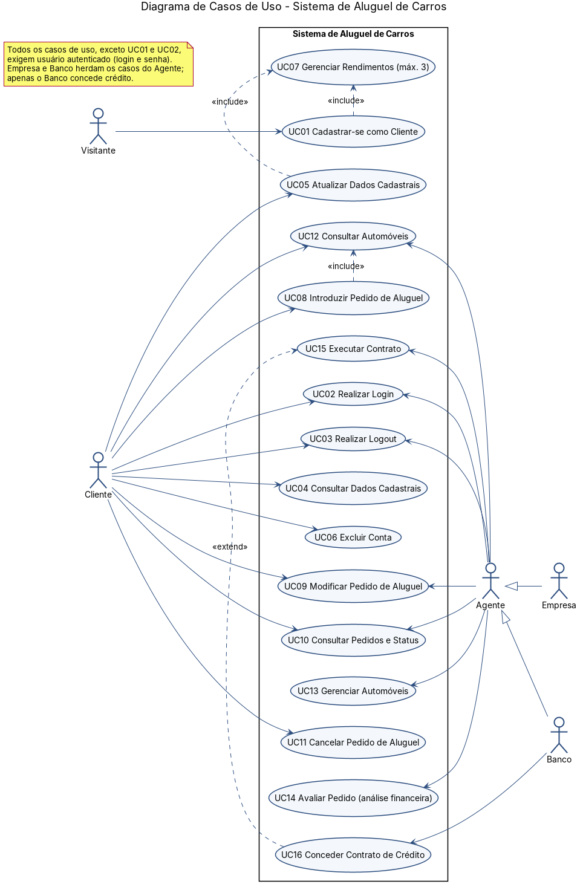
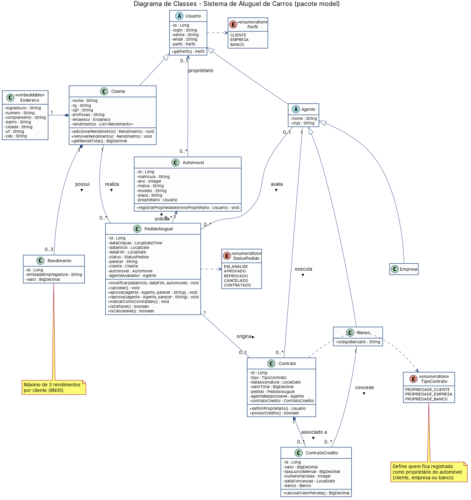
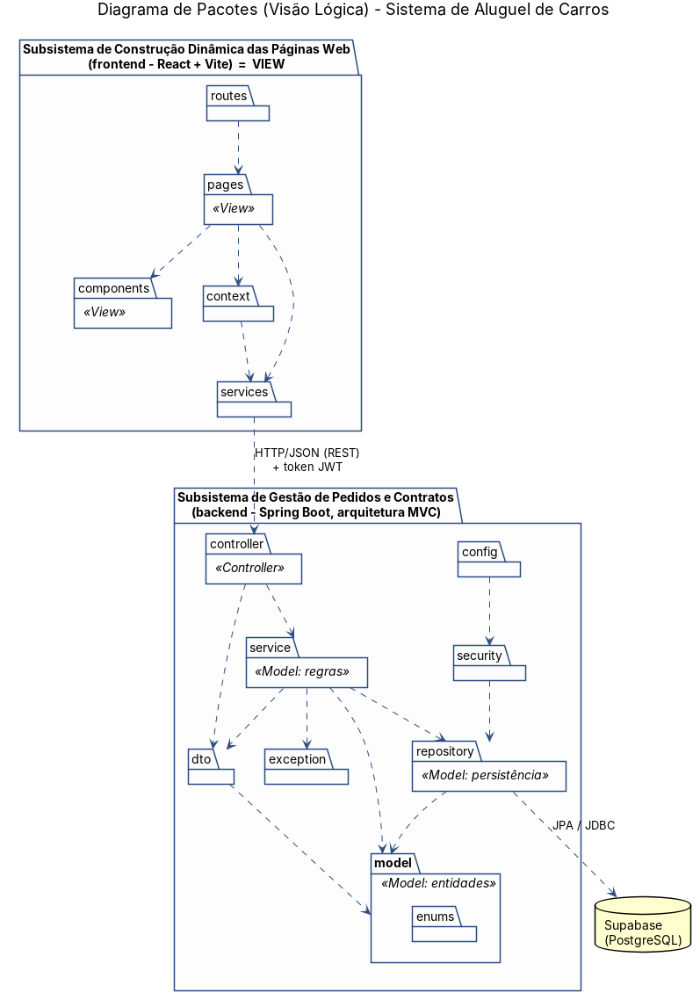

# Modelagem — Sistema de Aluguel de Carros (LAB02 · DIAW)

Documento de modelagem: premissas, regras de negócio, histórias de usuário, diagramas UML (casos de uso, classes, pacotes) e organização do back-end.

> Os fontes PlantUML (`.puml`) e as imagens (`.png` / `.svg`) estão em `docs/diagramas/`. Quando o modelo mudar, edite o `.puml`, gere a imagem de novo e faça commit das duas, porque o professor avalia as versões dos modelos no GitHub.

---

## 1. Premissas adotadas

O enunciado deixa alguns pontos em aberto. Estas foram as decisões tomadas (vale confirmar em aula):

| # | Premissa |
|---|----------|
| P1 | O **cliente se cadastra sozinho** (tela pública de cadastro). Os **agentes** (empresas e bancos) são criados por carga inicial (`DataSeeder`), porque o enunciado não descreve como eles se cadastram. |
| P2 | Os **automóveis são cadastrados pelos agentes**. O enunciado não diz quem faz isso, mas o pedido precisa de um carro já existente. |
| P3 | Login com **usuário + senha** feito pelo **Spring Security + JWT**. O Supabase é usado só como banco PostgreSQL, não como Supabase Auth. |
| P4 | O ciclo do pedido é: `EM_ANALISE → APROVADO / REPROVADO → CONTRATADO`, e o pedido pode ir para `CANCELADO` antes de ser contratado. |
| P5 | “Matrícula” e “placa” são guardadas como campos diferentes, como pede o enunciado. A matrícula pode ser tratada como o RENAVAM. |

---

## 2. Regras de Negócio

**Acesso e usuários**

- **RN01** – O sistema só pode ser usado depois de cadastro prévio e autenticação (login com usuário e senha). Todas as rotas, exceto cadastro e login, exigem token válido.
- **RN02** – O login (nome de usuário) é único. A senha é guardada criptografada com BCrypt e nunca é devolvida pela API.
- **RN03** – Há três perfis: **CLIENTE**, **EMPRESA** e **BANCO**. Empresa e Banco são **Agentes**. O perfil define o que o usuário pode fazer.

**Cliente (contratante)**

- **RN04** – Do cliente são guardados os dados de identificação (**RG, CPF, Nome, Endereço**) e a **profissão**. Todos são obrigatórios.
- **RN05** – O cliente pode informar **no máximo 3** entidades empregadoras com os respectivos rendimentos. Cada rendimento precisa de um valor maior que zero.
- **RN06** – CPF e RG são únicos no sistema. O CPF precisa ter formato válido.
- **RN07** – O cliente só pode consultar e alterar os próprios dados.

**Pedido de aluguel**

- **RN08** – Só o **cliente** pode **introduzir** pedidos. Todo pedido novo nasce com status **EM_ANALISE**.
- **RN09** – O cliente só pode **consultar, modificar e cancelar os próprios pedidos**.
- **RN10** – O cliente só pode **modificar** um pedido enquanto ele estiver **EM_ANALISE**.
- **RN11** – O cliente pode **cancelar** um pedido enquanto ele estiver **EM_ANALISE** ou **APROVADO**. Depois de **CONTRATADO**, não pode mais cancelar.
- **RN12** – Pedidos **CANCELADOS** ou **REPROVADOS** são finais e não podem mais ser alterados.
- **RN13** – A data de fim tem que ser posterior à data de início, e a data de início não pode estar no passado.

**Avaliação pelos agentes**

- **RN14** – Os **agentes** (empresas e bancos) podem **modificar** e **avaliar** pedidos que estão **EM_ANALISE**.
- **RN15** – A avaliação é uma **análise financeira**. Parecer positivo leva o pedido a **APROVADO**, e parecer negativo leva a **REPROVADO**. O sistema registra o parecer e o agente que avaliou.
- **RN16** – Só um pedido **APROVADO** pode ser levado à **execução do contrato**. Depois disso, o pedido passa para **CONTRATADO**.

**Contrato e automóvel**

- **RN17** – Cada pedido gera **no máximo um** contrato.
- **RN18** – Dependendo do **tipo de contrato**, o automóvel alugado fica registrado como propriedade do **cliente**, da **empresa** ou do **banco**.
- **RN19** – O aluguel pode estar associado a um **contrato de crédito** (opcional), que só pode ser **concedido por um agente do tipo Banco**.
- **RN20** – Do automóvel são registrados **matrícula, ano, marca, modelo e placa**. Matrícula e placa são únicas.
- **RN21** *(sugerida)* – Um automóvel não pode ter dois pedidos APROVADOS ou CONTRATADOS com períodos que se sobrepõem.
- **RN22** *(sugerida)* – O cliente não pode excluir a conta se tiver pedido CONTRATADO.

### Ciclo de vida do pedido

| Status atual | Ação | Quem | Novo status |
|---|---|---|---|
| — | Introduzir pedido | Cliente | EM_ANALISE |
| EM_ANALISE | Modificar | Cliente / Agente | EM_ANALISE |
| EM_ANALISE | Avaliar (positivo) | Agente | APROVADO |
| EM_ANALISE | Avaliar (negativo) | Agente | REPROVADO |
| EM_ANALISE / APROVADO | Cancelar | Cliente | CANCELADO |
| APROVADO | Executar contrato | Agente | CONTRATADO |

---

## 3. Histórias de Usuário

| ID | História | Critérios de aceitação |
|---|---|---|
| **US01** | Como **visitante**, quero **me cadastrar como cliente** informando meus dados pessoais e rendimentos, para poder usar o sistema. | RG, CPF, nome, endereço, profissão, login e senha obrigatórios; até 3 rendimentos; CPF/RG/login únicos (RN04–RN06). |
| **US02** | Como **usuário** (cliente ou agente), quero **fazer login com usuário e senha**, para acessar as funcionalidades do meu perfil. | Credenciais inválidas → erro 401; login válido devolve token e perfil; sem token não acessa nada (RN01). |
| **US03** | Como **usuário**, quero **sair do sistema (logout)**, para proteger minha conta. | Token removido do front-end; rotas protegidas redirecionam para o login. |
| **US04** | Como **cliente**, quero **consultar meus dados cadastrais**, para conferir o que está registrado. | Mostra só os dados do cliente logado (RN07). |
| **US05** | Como **cliente**, quero **atualizar meus dados e rendimentos**, para mantê-los corretos. | Não permite mais de 3 rendimentos (RN05); CPF continua único. |
| **US06** | Como **cliente**, quero **excluir minha conta**, para deixar de usar o sistema. | Não permite excluir se houver pedido CONTRATADO (RN22). |
| **US07** | Como **cliente**, quero **ver os automóveis disponíveis**, para escolher qual alugar. | Lista marca, modelo, ano e placa. |
| **US08** | Como **cliente**, quero **introduzir um pedido de aluguel**, para solicitar um automóvel. | Pedido criado com status EM_ANALISE; datas válidas (RN08, RN13). |
| **US09** | Como **cliente**, quero **consultar meus pedidos e seus status**, para acompanhar o andamento. | Lista só os pedidos do cliente, com status e parecer (RN09). |
| **US10** | Como **cliente**, quero **modificar um pedido**, para corrigir datas ou o automóvel. | Só se o status for EM_ANALISE (RN10). |
| **US11** | Como **cliente**, quero **cancelar um pedido**, para desistir do aluguel. | Só se o status for EM_ANALISE ou APROVADO (RN11). |
| **US12** | Como **agente**, quero **cadastrar e manter automóveis**, para que fiquem disponíveis para aluguel. | Matrícula e placa únicas (RN20). |
| **US13** | Como **agente**, quero **listar os pedidos em análise**, para saber o que preciso avaliar. | Filtro por status. |
| **US14** | Como **agente**, quero **modificar um pedido em análise**, para ajustar condições antes do parecer. | Só se o status for EM_ANALISE (RN14). |
| **US15** | Como **agente**, quero **avaliar financeiramente um pedido**, dando parecer positivo ou negativo. | Positivo → APROVADO; negativo → REPROVADO; registra parecer e agente (RN15). |
| **US16** | Como **agente**, quero **executar o contrato de um pedido aprovado**, definindo o tipo de contrato. | Só para pedido APROVADO; pedido vira CONTRATADO; proprietário do carro definido pelo tipo (RN16–RN18). |
| **US17** | Como **banco**, quero **conceder um contrato de crédito** associado ao aluguel, para financiar o cliente. | Só perfil BANCO; valor, juros e parcelas obrigatórios (RN19). |

---

## 4. Diagramas

### 4.1 Diagrama de Casos de Uso


### 4.2 Diagrama de Classes


### 4.3 Diagrama de Pacotes (Visão Lógica)


O sistema se divide nos **dois subsistemas** do enunciado:

- **Gestão de Pedidos e Contratos** → back-end Spring Boot (Controller + Model do MVC).
- **Construção Dinâmica das Páginas Web** → front-end React + Vite (View do MVC).

---

## 5. Estrutura do Back-end (Spring Boot · MVC)

### 5.1 Onde fica cada coisa no MVC

| MVC | Onde fica |
|---|---|
| **Model** | `model/` (entidades JPA), `repository/` (acesso ao Supabase) e `service/` (regras de negócio) |
| **View** | front-end React (consome a API REST) |
| **Controller** | `controller/` (endpoints REST) |

### 5.2 Árvore de arquivos

Pacote base: `br.pucminas.aluguelcarros` (troque pelo nome que preferir).

```
backend/
├── pom.xml
└── src/main/
    ├── resources/
    │   └── application.properties
    └── java/br/pucminas/aluguelcarros/
        ├── AluguelCarrosApplication.java
        │
        ├── config/
        │   ├── SecurityConfig.java          # rotas públicas/protegidas, CORS, BCrypt, filtro JWT
        │   └── DataSeeder.java              # cria agentes (Empresa/Banco) e alguns carros de exemplo
        │
        ├── security/
        │   ├── JwtService.java              # gera e valida o token
        │   ├── JwtAuthenticationFilter.java # lê o header Authorization em cada requisição
        │   └── UsuarioDetailsService.java   # carrega o usuário pelo login (UserDetailsService)
        │
        ├── model/
        │   ├── Usuario.java                 # abstract, @Inheritance(JOINED)
        │   ├── Cliente.java
        │   ├── Endereco.java                # @Embeddable
        │   ├── Rendimento.java
        │   ├── Agente.java                  # abstract
        │   ├── Empresa.java
        │   ├── Banco.java
        │   ├── Automovel.java
        │   ├── PedidoAluguel.java
        │   ├── Contrato.java
        │   ├── ContratoCredito.java
        │   └── enums/
        │       ├── Perfil.java
        │       ├── StatusPedido.java
        │       └── TipoContrato.java
        │
        ├── repository/
        │   ├── UsuarioRepository.java       # findByLogin, existsByLogin
        │   ├── ClienteRepository.java       # existsByCpf, existsByRg
        │   ├── AgenteRepository.java
        │   ├── AutomovelRepository.java     # existsByPlaca, existsByMatricula
        │   ├── PedidoAluguelRepository.java # findByClienteId, findByStatus
        │   └── ContratoRepository.java      # existsByPedidoId
        │
        ├── dto/
        │   ├── auth/       LoginRequest, LoginResponse
        │   ├── cliente/    ClienteRequest, ClienteResponse, EnderecoDTO, RendimentoDTO
        │   ├── automovel/  AutomovelRequest, AutomovelResponse
        │   ├── pedido/     PedidoRequest, PedidoResponse, AvaliacaoRequest
        │   └── contrato/   ContratoRequest, ContratoResponse, ContratoCreditoRequest
        │
        ├── service/
        │   ├── AuthService.java             # login + cadastro de cliente
        │   ├── ClienteService.java          # CRUD de cliente (RN04–RN07)
        │   ├── AutomovelService.java        # CRUD de automóvel (RN20)
        │   ├── PedidoAluguelService.java    # criar/modificar/cancelar/avaliar (RN08–RN16)
        │   └── ContratoService.java         # executar contrato + crédito (RN16–RN19)
        │
        ├── controller/
        │   ├── AuthController.java
        │   ├── ClienteController.java
        │   ├── AutomovelController.java
        │   ├── PedidoAluguelController.java
        │   └── ContratoController.java
        │
        └── exception/
            ├── BusinessException.java          # violação de regra → 422/400
            ├── ResourceNotFoundException.java  # → 404
            └── GlobalExceptionHandler.java     # @RestControllerAdvice, padroniza o JSON de erro
```

> Os DTOs podem ser `record`s do Java, um arquivo por classe. As subpastas de `dto/` são opcionais: se o tempo estiver curto, deixe todos direto em `dto/`.

### 5.3 O que vai em cada camada

- **model/**: as entidades com `@Entity`. `Usuario` usa `@Inheritance(strategy = InheritanceType.JOINED)`, o que cria as tabelas `usuario`, `cliente`, `agente`, `empresa` e `banco`. `Cliente` tem `@OneToMany(cascade = ALL, orphanRemoval = true)` para `Rendimento`, e o método `adicionarRendimento` lança exceção se já houver 3. `PedidoAluguel` tem os métodos de transição de status (`aprovar`, `cancelar`…) que conferem o status atual antes de mudar.
- **repository/**: interfaces que estendem `JpaRepository<Entidade, Long>`. Não têm lógica.
- **service/**: `@Service` com `@Transactional`. Toda regra de negócio fica aqui ou nas entidades, nunca no controller. O service recebe o usuário logado para conferir se ele é dono do recurso (RN07, RN09).
- **controller/**: `@RestController`. Recebe DTO com `@Valid`, chama o service e devolve DTO. Não devolva entidades diretamente.
- **dto/**: contratos de entrada e saída da API, com validações (`@NotBlank`, `@Size`, `@Past`…). `ClienteRequest.rendimentos` usa `@Size(max = 3)`.
- **security/** e **config/**: autenticação. `SecurityConfig` libera `/api/auth/**` e protege o resto por perfil (`hasRole("CLIENTE")`, `hasAnyRole("EMPRESA","BANCO")`).
- **exception/**: erros padronizados para o front-end mostrar mensagens.

### 5.4 Endpoints sugeridos

| Método | Rota | Perfil | Caso de uso |
|---|---|---|---|
| POST | `/api/auth/register` | público | UC01 Cadastrar-se |
| POST | `/api/auth/login` | público | UC02 Login |
| GET | `/api/clientes/me` | CLIENTE | UC04 |
| PUT | `/api/clientes/me` | CLIENTE | UC05 / UC07 |
| DELETE | `/api/clientes/me` | CLIENTE | UC06 |
| GET | `/api/automoveis` | todos | UC12 |
| POST / PUT / DELETE | `/api/automoveis/{id}` | EMPRESA, BANCO | UC13 |
| POST | `/api/pedidos` | CLIENTE | UC08 |
| GET | `/api/pedidos/meus` | CLIENTE | UC10 |
| GET | `/api/pedidos?status=EM_ANALISE` | EMPRESA, BANCO | UC10 (agente) |
| PUT | `/api/pedidos/{id}` | CLIENTE, EMPRESA, BANCO | UC09 |
| PATCH | `/api/pedidos/{id}/cancelar` | CLIENTE | UC11 |
| PATCH | `/api/pedidos/{id}/avaliar` | EMPRESA, BANCO | UC14 |
| POST | `/api/contratos` | EMPRESA, BANCO | UC15 |
| POST | `/api/contratos/{id}/credito` | BANCO | UC16 |

### 5.5 Dependências (start.spring.io)

Maven · Java 25 · Spring Boot 4.0.x · dependências: **Spring Web**, **Spring Data JPA**, **Spring Security**, **Validation**, **PostgreSQL Driver** e **Lombok** (opcional). Depois, adicione a biblioteca **jjwt** (`jjwt-api`, `jjwt-impl`, `jjwt-jackson`) no `pom.xml`.

### 5.6 `application.properties` (Supabase)

```properties
spring.datasource.url=${DB_URL}        # jdbc:postgresql://<host-do-pooler>:5432/postgres
spring.datasource.username=${DB_USER}  # no pooler costuma ser postgres.<project-ref>
spring.datasource.password=${DB_PASSWORD}
spring.jpa.hibernate.ddl-auto=update
spring.jpa.open-in-view=false
jwt.secret=${JWT_SECRET}
jwt.expiration-ms=86400000
```

> Pegue a URL em *Supabase → Connect*. A conexão direta do plano gratuito usa só IPv6, então em redes comuns use o **Session pooler**. Não suba a senha para o GitHub: use variáveis de ambiente.

---

## 6. Estrutura sugerida do Front-end (React + Vite)

```
frontend/src/
├── services/api.js          # axios com baseURL e header Authorization
├── context/AuthContext.jsx  # guarda token/perfil, login(), logout()
├── routes/                  # AppRoutes.jsx, PrivateRoute.jsx (bloqueia sem login / por perfil)
├── components/              # Navbar, Formularios, TabelaPedidos, StatusBadge...
└── pages/
    ├── Login.jsx, Cadastro.jsx
    ├── cliente/  MeusDados.jsx, MeusPedidos.jsx, NovoPedido.jsx
    └── agente/   PedidosAnalise.jsx, Automoveis.jsx, Contrato.jsx
```

---

## 7. Ordem sugerida de implementação

1. Modelagem (este documento + diagramas) e commit.
2. Projeto Spring + conexão com o Supabase + entidades e repositories.
3. Autenticação (cadastro de cliente, login JWT, `SecurityConfig`, `DataSeeder` com agentes).
4. CRUD de cliente (back + telas).
5. Protótipo: cliente cria pedido e vê o status; agente avalia.
6. Contrato e crédito (se der tempo) e revisão dos diagramas.